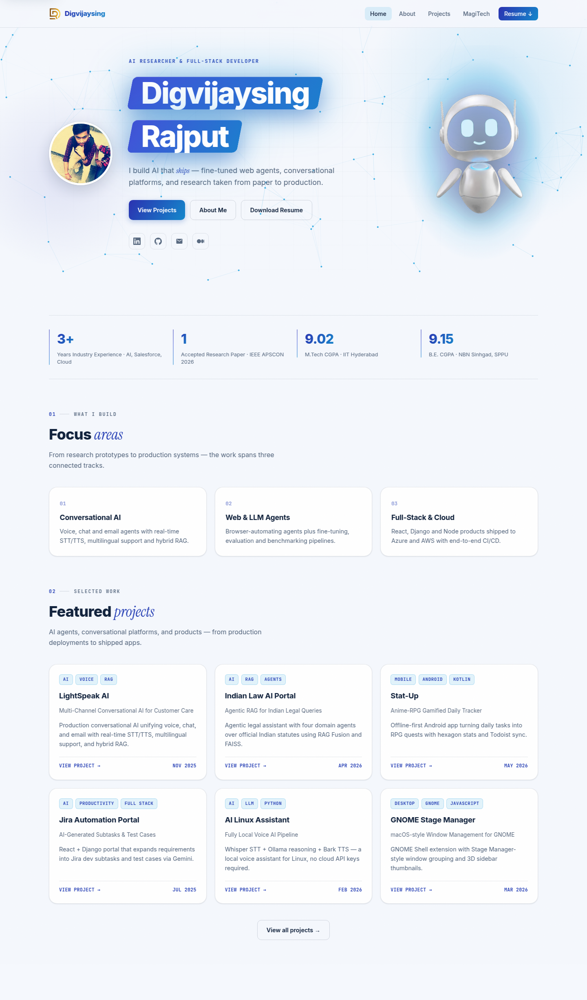

# <a href="https://itsDigvijaysing.github.io/" target="_blank">My Portfolio Website</a>

[](https://github.com/itsDigvijaysing/itsDigvijaysing.github.io)
[](https://itsDigvijaysing.github.io/)
[](https://github.com/itsDigvijaysing)

> <b>Live Domain</b>  
> https://itsDigvijaysing.github.io/

 <p align="justify">This website serves as an online portfolio showcasing my web presence, resume, story, and featured projects.</p>

## Tech Stack

Built with **React 18 + Vite** (multi-page SPA via React Router) and a hand-rolled CSS design system, with GSAP for the hero title animation. Deployed to **GitHub Pages** through a GitHub Actions workflow (`.github/workflows/deploy.yml`) that runs `npm run build` and publishes `dist/`. The build ends with `scripts/prerender-routes.mjs`, which writes one HTML file per page so every route is served with HTTP 200 and its own title and link-preview tags.

```bash
npm install     # install deps
npm run dev     # local dev server
npm run build   # production build → dist/
```

## Domain

<li>Live Domain: https://itsDigvijaysing.github.io/</li>
<li>Old Domain: MagiTech.site (MagiTech now lives at https://magitech.in)</li>
<li>Old Domain: www.Digvijaysing.tech</li>
<li>Old Domain: https://DBRajput.github.io</li>
<li>Old Domain: www.BusyBoy.me</li>

## Repo

<li>Default Repo: https://github.com/itsDigvijaysing/itsDigvijaysing.github.io.git/</li>
<li>Old Repo: https://royaltechie.github.io/digvijaysing.github.io/</li>

## Current Layout



## Previous Layout


